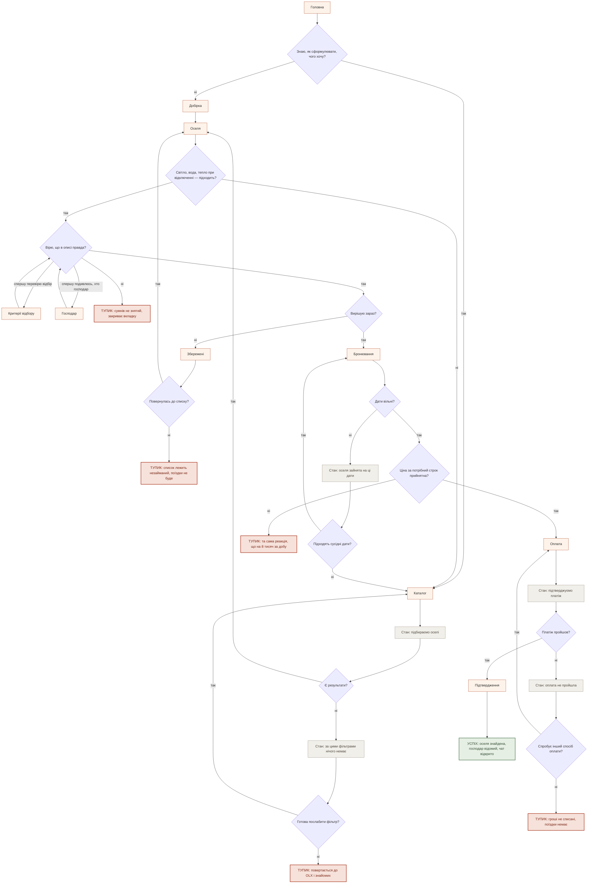
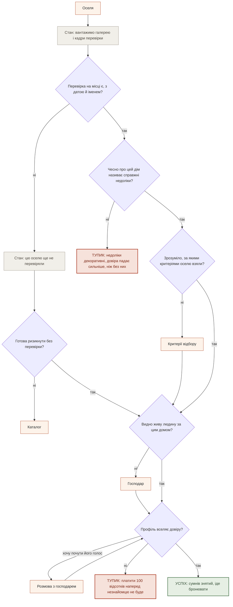
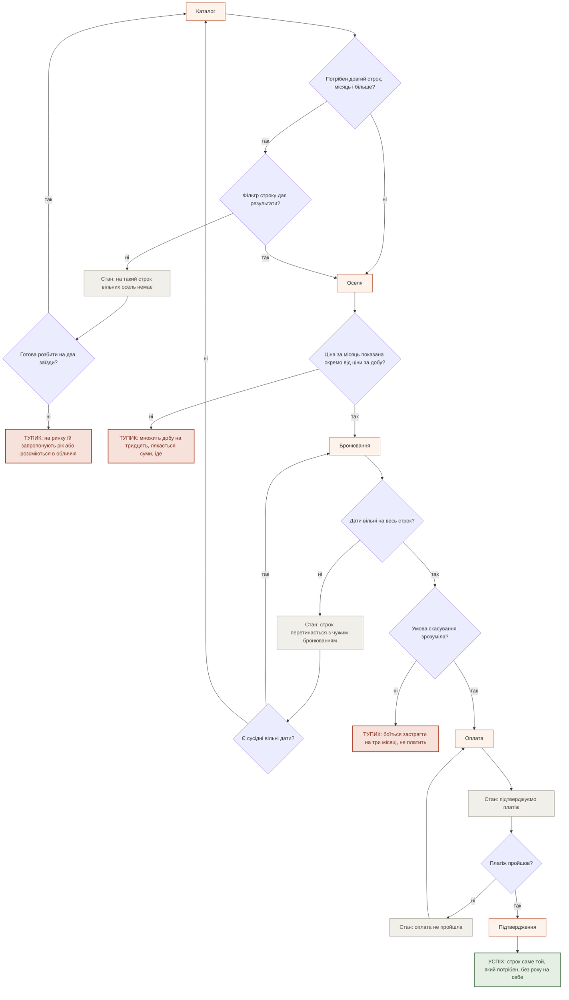
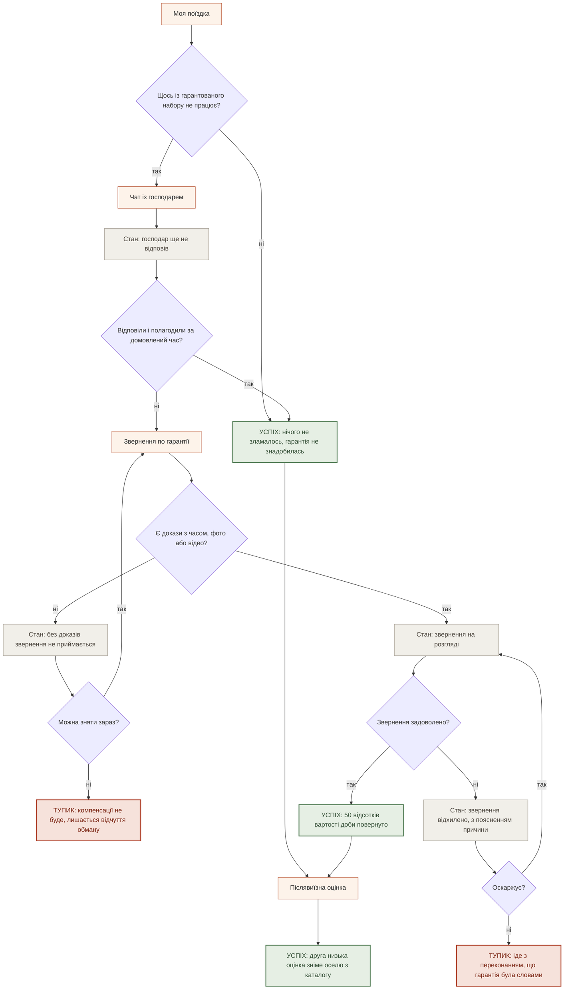

# User flows

**Крок 3.** Дата: 16.10.2026. Екрани — зі [`sitemap.md`](./sitemap.md), розділ «Екрани». Джоби — з [`research/jtbd.md`](./research/jtbd.md). Нових екранів жоден flow не зажадав, тож `sitemap.md` лишається без доповнень.

**Легенда.** `[Прямокутник]` — екран зі sitemap. `{Ромб}` — точка рішення людини або системи. Пунктирні вузли — **стани екрана**, не екрани: порожньо, помилка, очікування. Теракотові — **тупики**, де людина йде ні з чим. Зелені — успіх.

> Два уточнення до постановки. Перше: **кімнат ми не здаємо**, завжди ціле помешкання — тому у flow людина шукає оселю, а не кімнату. Друге: **кроку «власник відповів на заявку» в нас немає** — немає ні запиту на бронювання, ні схвалення власником, ні застави. Замість «відповіли на заявку?» ту саму роль відіграють інші розвилки: **дати вільні?**, **платіж пройшов?**, а в гарантійному потоці — справжнє **звернення відхилено**.

---

## MAIN JOB — безпечно знайти, з ким і де жити

> Коли я вже не відновлююсь там, де живу, я хочу перебути найважчий період у місці, де вночі тихо і щоденний побут не забирає останні сили, щоб повернути собі сон і здатність жити далі.

Персона: **«Та, хто чотири роки не спить»** ([`personas.md`](./research/personas.md), primary).

**Рішення в цьому потоці**

1. **Знаю, як сформулювати?** Розвилка на самому вході. «Ні» веде в Добірку, бо людина впізнає стан швидше, ніж називає параметри. «Так» веде в Каталог із фільтрами.
2. **Є результати?** Системна, не людська.
3. **Підходить гарантований набір?** Перша змістовна відмова: вона дивиться не на красу, а на те, чи буде вода, коли вимкнуть світло.
4. **Вірю, що в описі правда?** Вузол, через який проходить увесь продукт. Має два обходи — Критерії відбору й Господар, обидва повертають сюди ж.
5. **Вирішую зараз?** Відкладання — нормальний стан, а не збій.
6. **Дати вільні? · Ціна прийнятна? · Платіж пройшов?** Три системні перевірки на фінішній прямій.

**Стани**

| Стан | Де | Що показуємо |
|---|---|---|
| Очікування | Каталог | Підбираємо оселі |
| Порожньо | Каталог | За цими фільтрами нічого немає — і одразу шлях назад до послаблення фільтра |
| Помилка | Бронювання | Оселя зайнята на ці дати, з пропозицією сусідніх |
| Очікування | Оплата | Підтверджуємо платіж |
| Помилка | Оплата | Оплата не пройшла, гроші не списані |

**П'ять тупиків**

| Тупик | Де губимо | Чи можна відіграти |
|---|---|---|
| **Повертається до OLX** | Порожня видача | Так — порожній екран мусить вести в Добірки, а не бути глухим |
| **Сумнів не знятий** | Оселя | Так, і це головна робота продукту: перевірка, недоліки, господар |
| **Список лежить незайманий** | Збережені | Частково. Нагадувати ми не вміємо й не хочемо |
| **Ціна відлякала** | Бронювання | Ні. Це рішення про каталог, не про інтерфейс |
| **Оплата не пройшла двічі** | Оплата | Так — кілька способів оплати вже в брифі |

---

## R3 — переконатись, що місце справжнє і таке, як описано

> Коли я плачу всю суму наперед людині, якої не знаю, я хочу бачити доказ, що оселя існує і виглядає як на фото, щоб не приїхати в інше місце.

У матриці [`jtbd.md`](./research/jtbd.md) цей джоб дає 3 бали primary і 3 бали персоні ③.

**Рішення в цьому потоці**

1. **Перевірка є?** Єдина розвилка, якої немає в жодного конкурента: Airbnb перевірку робить, але доказ від гостя ховає ([ст. 3776](https://www.airbnb.com.ua/help/article/3776)).
2. **Недоліки справжні?** Небезпечна розвилка. Декоративний список шкодить більше, ніж його відсутність, бо читається як маніпуляція — звідси правило «щонайменше три справжні» зі [`sitemap.md`](./sitemap.md).
3. **Зрозуміло, за якими критеріями взяли?** Обхід у Критерії відбору — вхід із картки, не з меню.
4. **Профіль вселяє довіру?** Тут Розмова з господарем робить свою роботу: чат відкривається тільки після оплати, тож це єдиний спосіб почути людину заздалегідь.

**Стани**

| Стан | Де | Що показуємо |
|---|---|---|
| Очікування | Оселя | Вантажимо галерею і кадри перевірки |
| Порожньо | Оселя | Цю оселю ще не перевіряли — сказати прямо, а не промовчати |

**Тупики**

**Недоліки декоративні.** Найтонше місце: порожній блок «Чесно про цей дім» гірший за його відсутність.
**Профіль не вселяє довіри.** Кінцевий тупик цього джоба. Відіграти можна лише вмістом — обличчям, ім'ям, голосом, — не кнопкою.

---

## R4 — домовитись саме на той строк, який потрібен

> Коли мені потрібно перебути лише найважчі місяці, я хочу домовитись саме на цей строк, не беручи на себе рік, щоб не платити за житло тоді, коли воно мені вже не потрібне.

У матриці — 3 бали primary, 3 бали ③, 3 бали ④. **Найсильніший related job із усіх.**

**Рішення в цьому потоці**

1. **Потрібен довгий строк?** Розвилка, яку ринок не ставить узагалі: у Hutshub 90 відсотків бронювань — до трьох діб.
2. **Ціна за місяць показана окремо?** Технічно дрібниця, по суті — весь джоб. Якщо місячної ціни немає, людина множить добу на тридцять і йде. Тому в [`sitemap.md`](./sitemap.md) «строки й ціна за добу, тиждень, місяць» стоять усередині Оселі, а не в кошику.
3. **Умова скасування зрозуміла?** Для довгого строку страшніше за ціну: у нас умова єдина для всіх, і це треба показати до оплати, а не в оферті.

**Стани**

| Стан | Де | Що показуємо |
|---|---|---|
| Порожньо | Каталог | На такий строк вільних осель немає — із пропозицією розбити на два заїзди |
| Помилка | Бронювання | Строк перетинається з чужим бронюванням |
| Очікування, помилка | Оплата | Ті самі, що в main job |

**Тупики**

**Розсміються в обличчя** — те, що відбувається з нею на ринку сьогодні ([LB.ua, 15.10.2026](https://lb.ua/society/2026/10/15/773364_vid_pereyaslava_uzhgoroda_de.html)). Якщо порожній стан не запропонує виходу, ми повторимо ринок у кращому оформленні.
**Множить добу на тридцять** — тупик, який коштує один рядок у картці.
**Боїться застрягти** — знімається текстом умови скасування на екрані бронювання.

---

## E1 — перестати додавати собі невизначеності

> Коли я вже живу в оселі й щось із обіцяного не працює, я хочу знати, що робити і на що маю право, щоб не з'ясовувати це з нуля посеред поїздки.

Єдиний потік, де справді є **відхилення заявки**: гарантія без механізму розгляду — просто текст.

**Рішення в цьому потоці**

1. **Щось не працює?** Вхід не з довідки, а з «Моєї поїздки» — коли немає води, людина відкриває свою поїздку, не FAQ.
2. **Господар полагодив сам?** Навмисний перший крок: більшість випадків мусить закриватись тут, інакше платформа платить за кожну перегорілу лампочку.
3. **Є докази?** Найжорсткіша розвилка. Без неї гарантія не працює, але вона ж створює тупик для того, хто не здогадався зняти відео вчасно — тому попередити про це треба **в підтвердженні бронювання**, а не в момент звернення.
4. **Звернення задоволено?** Єдина справжня відмова в усьому продукті. Пояснення причини обов'язкове.

**Стани**

| Стан | Де | Що показуємо |
|---|---|---|
| Очікування | Чат | Господар ще не відповів, із зазначенням домовленого часу |
| Порожньо | Звернення по гарантії | Без доказів звернення не приймається — сказати до того, як людина заповнить форму |
| Очікування | Звернення по гарантії | На розгляді, зі строком |
| Помилка | Звернення по гарантії | Відхилено, з причиною і шляхом оскарження |

**Тупики**

**Не зняла доказ вчасно.** Передбачити можна лише заздалегідь — рядком у підтвердженні бронювання.
**Гарантія виявилась словами.** Найдорожчий тупик у продукті: людина, якій відмовили, забирає з собою те саме відчуття, проти якого ми будуємося. Тому причина відмови й шлях оскарження — не дрібниця інтерфейсу, а умова, щоб обіцянка лишалась обіцянкою.
