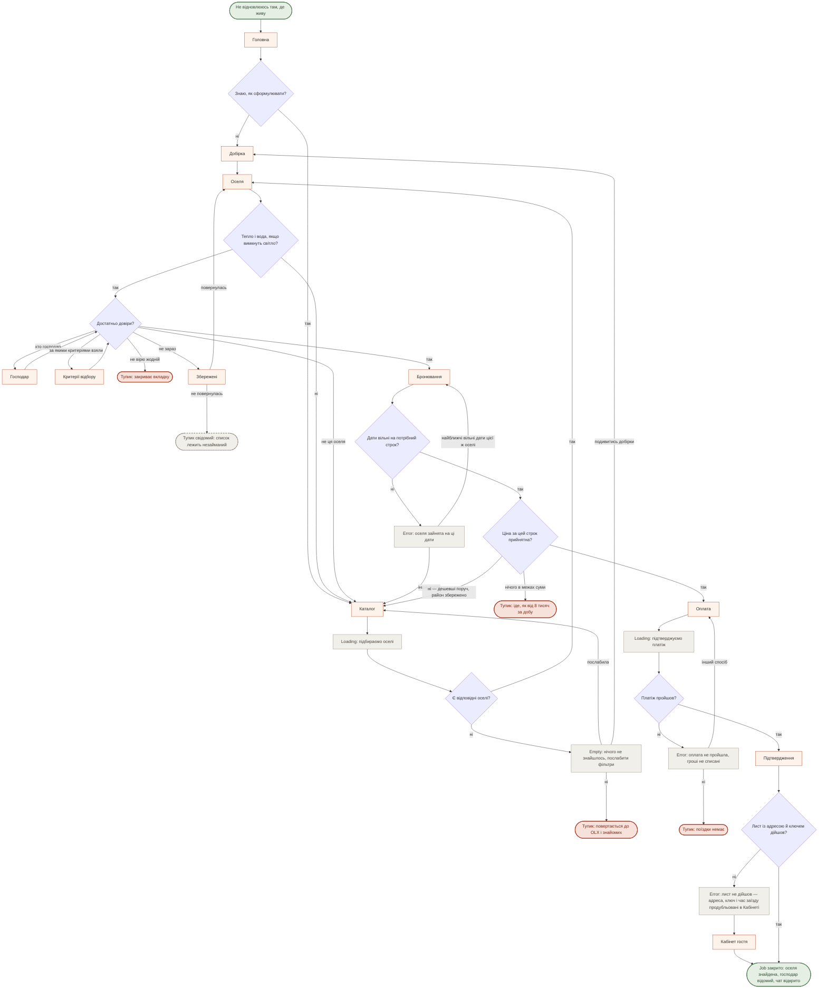
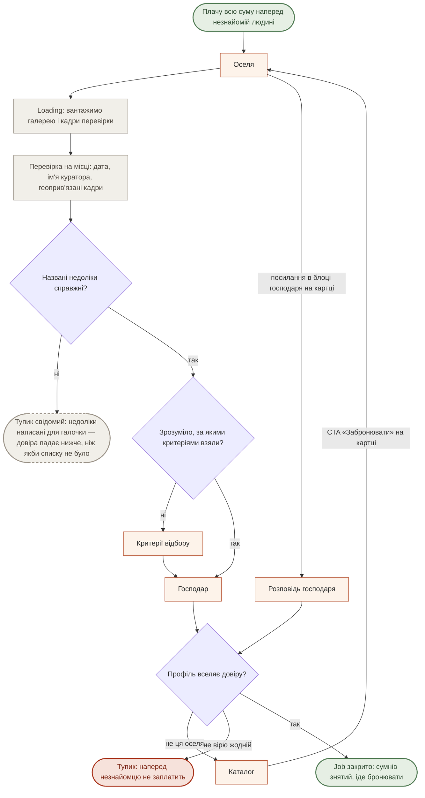
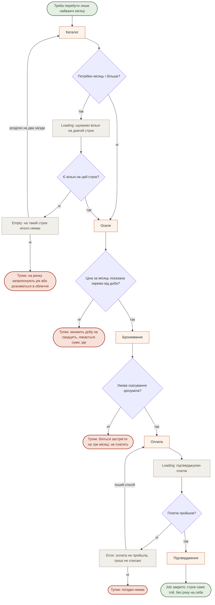
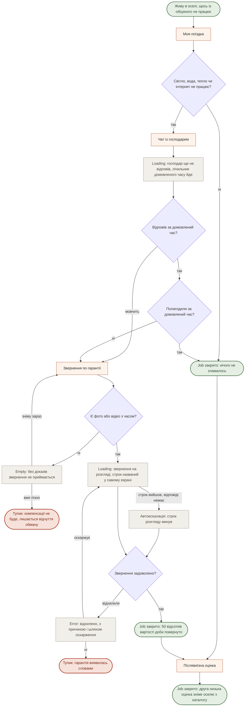
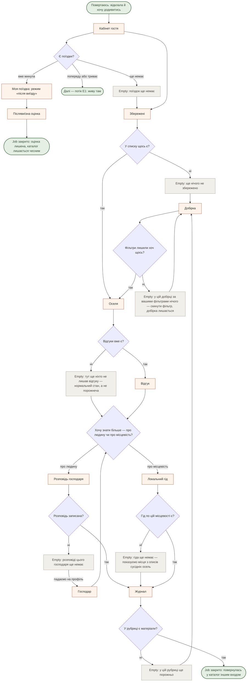

# User flows

**Крок 3.** Дата: 16.10.2026, правки за самоперевіркою — 21.10.2026. Екрани — зі [`sitemap.md`](./sitemap.md), розділ «Екрани». Джоби — з [`research/jtbd.md`](../research/jtbd.md). Нових екранів жоден flow не зажадав.

**П'ять потоків:** MAIN, три найсильніші related — R3, R4, E1 — і п'ятий, «повертаюсь і читаю». П'ятий домальований після самоперевірки: без нього Відгук, Журнал, Кабінет гостя й Локальний гід не фігурували в жодному потоці.

**Конвенція.** `Start([...])` — тригер, з якого людина заходить. `[Екран]` — екран зі sitemap. `{Розвилка?}` — рішення людини або системи. `Loading:` / `Empty:` / `Error:` — **стани екрана**, не екрани. `Тупик([...])` — місце, де людина йде ні з чим; **пунктирний тупик лишений свідомо** — його не лагодять кнопкою. `Job закрито([...])` — успіх. Кольори через `classDef` — суто для читабельності, без них усе рендериться так само.

> **Три місця, де наш продукт розходиться зі звичним флоу маркетплейса житла.**
>
> **Кімнат немає** — завжди ціле помешкання, тож людина шукає оселю.
> **Схвалення відбувається одразу.** Гроші знімаються в момент бронювання, і власник підтверджує одразу — заявки, очікування й застави немає. Якщо щось піде не так, бронювання скасовується, а гроші повертаються. Тому замість «відповіли на заявку?» працюють **дати вільні?** і **платіж пройшов?**.
> **Чат відкривається після оплати, а не до неї.** У звичайному флоу діалог — спосіб набути довіри; у нас довіру мусять набути перевірка, блок недоліків і Розповідь господаря. Єдине справжнє відхилення в усьому продукті — **звернення по гарантії**.

---

## MAIN JOB — безпечно знайти, з ким і де жити

> Коли вдома вже не виходить відпочити, я хочу побути там, де вночі тихо, а вранці є вода й тепло, щоб повернути собі сон, сили та натхнення.

Персона: **«Та, хто їде нічого не робити»** ([`personas.md`](../research/personas.md), primary з 17.10.2026). Потік той самий і для тієї, хто їде надовго, — різниця лише в строку, який вона обирає на кроці дат.

**Розвилки**

1. **Знаю, як сформулювати?** На самому вході. «Ні» веде в Добірку, бо стан людина впізнає швидше, ніж називає параметри.
2. **Тепло і вода, якщо вимкнуть світло?** Перша змістовна відмова: вона дивиться не на красу.
3. **Достатньо довіри?** Вузол, через який проходить увесь продукт. Два обходи — Господар і Критерії відбору — обидва повертаються сюди ж.
4. **Дати вільні? · Ціна прийнятна? · Платіж пройшов?** Три системні перевірки на фініші. Тут у звичайному флоу стояло б «відповіли на заявку?».

**Стани:** `Loading` підбираємо оселі · `Empty` нічого не знайшлось, із двома виходами — послабити фільтр або піти в Добірки · `Error` оселя зайнята на ці дати, з найближчими вільними датами **цієї ж** оселі · `Loading` підтверджуємо платіж · `Error` оплата не пройшла · `Error` лист із ключем не дійшов — усе те саме лежить у Кабінеті.

**П'ять тупиків**

| Тупик | Де губимо | Що стоїть перед ним |
|---|---|---|
| Повертається до OLX | Порожня видача | Гілка в Добірки — порожній екран більше не пропонує лише «послабити фільтр» |
| Сумнів не знятий | Оселя | Вихід «не ця оселя» назад у каталог: недовіра буває до конкретного дому й конкретної людини, а не до всіх |
| Список лежить незайманий | Збережені | **Нічого, і свідомо.** Ми не надсилаємо нагадувань — тупик лишений пунктиром, щоб його не шукали як недоробку |
| Ціна відлякала | Бронювання | Гілка «дешевші поруч» зі збереженим районом. Далі вже не інтерфейс, а зафіксовані власниками ціни |
| Оплата не пройшла | Оплата | Гілка «інший спосіб» — кілька способів уже в брифі |

---

## R3 — переконатись, що місце і ціна справжні

> Коли я плачу всю суму наперед людині, якої не знаю, я хочу бачити доказ, що оселя існує і виглядає як на фото, щоб не приїхати в інше місце.

У матриці [`jtbd.md`](../research/jtbd.md) — 3 бали primary і 3 бали персоні ③.

**Розвилки**

1. **Перевірки тут немає як розвилки — і це навмисно.** Вона є в кожної оселі каталогу, тож питати «чи перевіряли» нема чого: потік просто показує доказ — дату, ім'я куратора, геоприв'язані кадри. Саме цей показ і є те, чого немає в жодного конкурента: Airbnb перевірку робить, але доказ від гостя ховає ([ст. 3776](https://www.airbnb.com.ua/help/article/3776)). Переперевірку призначає куратор, фіксованого циклу ми не обіцяємо — тому й стану «перевірка застаріла» на екрані немає.
2. **Недоліки справжні?** Найнебезпечніша. Ідеться про мінуси, названі в самому описі оселі — окремого блоку недоліків у нас немає. Написані **для галочки** — «далеко до магазину», «вранці співають півні» — шкодить **більше**, ніж його відсутність: людина бачить, що з нею граються, і перестає вірити й усьому іншому на екрані. Справжній недолік коштує власникові бронювань: туалет надворі, до крамниці сім кілометрів, узимку холодна підлога. Звідси два правила зі [`sitemap.md`](./sitemap.md): **щонайменше три справжні** і **пише їх платформа, не власник**.
3. **Профіль вселяє довіру?** Тут Розповідь господаря робить свою роботу, бо чат відкриється аж після оплати. Вона відкривається **з картки оселі**, з блоку господаря, а не через його профіль: інакше до неї три переходи замість двох, а R3 — 3 бали для primary.

**Стани:** `Loading` вантажимо галерею й кадри перевірки. Порожнього стану тут немає й бути не може: оселя без перевірки в каталог не потрапляє, а дата перевірки стоїть на екрані така, яка є.

**Тупики:** недоліки для галочки — **свідомий**, пунктиром: лагодиться не кнопкою, а тим, як ми пишемо тексти · профіль не вселяє довіри — перед ним стоїть вихід «не ця оселя» назад у каталог, бо недовіра буває до конкретного дому й конкретної людини. Далі відіграється вмістом: обличчям, ім'ям, голосом, — не кнопкою й не фільтром.

---

## R4 — домовитись саме на той строк, який потрібен

> Коли мені потрібно перебути лише найважчі місяці, я хочу домовитись саме на цей строк, не беручи на себе рік, щоб не платити за житло тоді, коли воно мені вже не потрібне.

3 бали primary, 3 бали ③, 3 бали ④. **Найсильніший related job із усіх.**

**Розвилки**

1. **Потрібен місяць і більше?** Розвилка, якої ринок не ставить узагалі: у Hutshub 90 відсотків бронювань — до трьох діб.
2. **Ціна за місяць окремо від доби?** Технічно рядок, по суті — весь джоб.
3. **Умова скасування зрозуміла?** Для довгого строку страшніше за ціну. У нас умова єдина для всіх — і це має стояти до оплати, а не в оферті.

**Стани:** `Loading` шукаємо вільні на довгий строк · `Empty` на такий строк нічого немає, із пропозицією розділити на два заїзди · `Loading` і `Error` на оплаті — той самий екран і ті самі дві гілки, що в MAIN: інший спосіб або явний тупик.

**Тупики:** «розсміються в обличчя» — те, що відбувається з нею на ринку сьогодні ([LB.ua, 15.10.2026](https://lb.ua/society/2026/10/15/773364_vid_pereyaslava_uzhgoroda_de.html)); якщо порожній стан не запропонує виходу, ми повторимо ринок у кращому оформленні · «множить добу на тридцять» коштує один рядок у картці · «боїться застрягти» знімається текстом умови скасування.

---

## E1 — перестати додавати собі невизначеності

> Коли я вже живу в оселі й щось із обіцяного не працює, я хочу знати, що робити і на що маю право, щоб не з'ясовувати це з нуля посеред поїздки.

Єдиний потік, де є **справжнє відхилення заявки**: гарантія без механізму розгляду — просто текст.

**Розвилки**

1. **Щось не працює?** Вхід із «Моєї поїздки», **не з довідки**: коли немає води, людина відкриває свою поїздку, а не FAQ.
2. **Господар полагодив сам?** Навмисний перший крок — більшість випадків мусить закриватись тут, інакше платформа платить за кожну перегорілу лампочку.
3. **Є докази?** Найжорсткіша. Без неї гарантія не працює, але вона ж створює тупик для того, хто не здогадався зняти відео вчасно — тому попередити треба **в підтвердженні бронювання**, а не в момент звернення.
4. **Звернення задоволено?** Єдина справжня відмова в продукті. Причина обов'язкова.

**Стани:** `Loading` господар ще не відповів, із лічильником домовленого часу — **мовчання й «не полагодив» розведені**: мовчання за домовлений час веде просто у Звернення, без повторних спроб достукатись · `Empty` без доказів не приймається — сказати **до** заповнення форми · `Loading` на розгляді, зі строком і автоескалацією, коли строк минув: платформа не має права мовчати всередині механізму, який ми продаємо як гарантію · `Error` відхилено, з причиною і шляхом оскарження.

**Тупики:** «не зняла доказ вчасно» — передбачається лише заздалегідь, рядком у підтвердженні · «гарантія виявилась словами» — найдорожчий тупик у продукті: людина, якій відмовили, забирає з собою рівно те відчуття, проти якого ми будуємося.

---

## Повертаюсь і читаю — R2 · S3 · P4 · E3

> Коли я вже відклала щось і повертаюсь, я хочу додивитись те, що лишила, і дізнатись про місце більше, щоб вибір не починався щоразу спочатку.

**Домальований після самоперевірки.** Чотири екрани — Відгук, Журнал, Кабінет гостя й Локальний гід — не фігурували в жодному потоці, хоча в матриці трасування мають Σ 1, 4, 3 і 2. Дві наші перевірки давали різну відповідь про одні й ті самі екрани; цей потік їх мирить. Тут же живуть **усі порожні стани**, яких бракувало: Збережені, Добірка, Відгук, Розповідь, Гід, Журнал, Кабінет.

**Розвилки**

1. **Є поїздки?** Кабінет — єдиний екран, який новий гість бачить порожнім ще до першої поїздки. Тому порожній стан веде не в нікуди, а в Збережені й далі в Добірки.
2. **Фільтри лишили хоч щось?** Добірка теж фільтрується, отже теж може спорожніти. Скидання фільтра **зберігає добірку**: людина не вилітає в загальний каталог.
3. **Відгуки вже є?** На старті їх немає **в усіх тридцяти осель**. «Тут ще ніхто не лишав відгуку» — нормальний стан, і написати його треба так, щоб він не читався як покинутий сайт.
4. **Про людину чи про місцевість?** Дві гілки глибини — Розповідь й Гід. Обидві не будуть заповнені на старті, тому обидві мають падіння: Розповідь — назад на профіль господаря, Гід — на місця з описів сусідніх осель.

**Стани:** сім порожніх — Кабінет, Збережені, Добірка, Відгук, Розповідь, Гід, Журнал. **Тупиків жодного:** з кожного порожнього екрана є вихід, і всі вони ведуть углиб каталогу, а не з нього.

**Чому тут немає Моєї поїздки в середньому режимі.** Поїздка, яка триває, — це потік E1; цей потік лише передає в нього. Три режими одного екрана — до заїзду, живу там, після виїзду — названі в [`sitemap.md`](./sitemap.md), розділ «Стани екранів».
