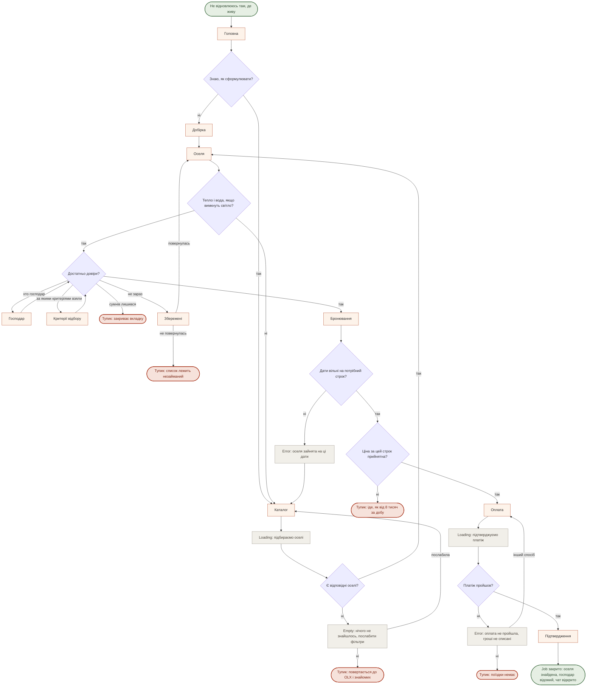
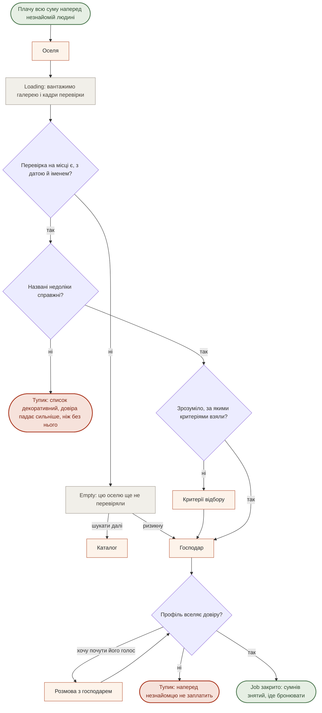
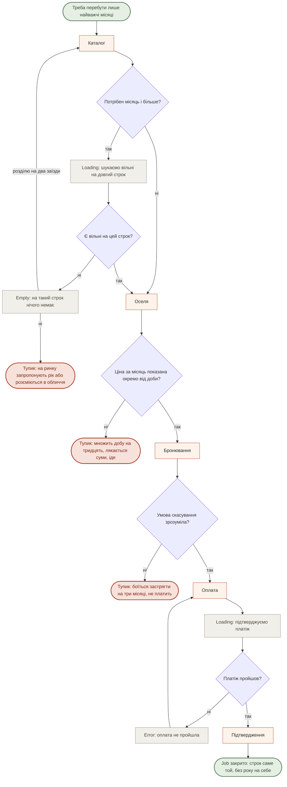
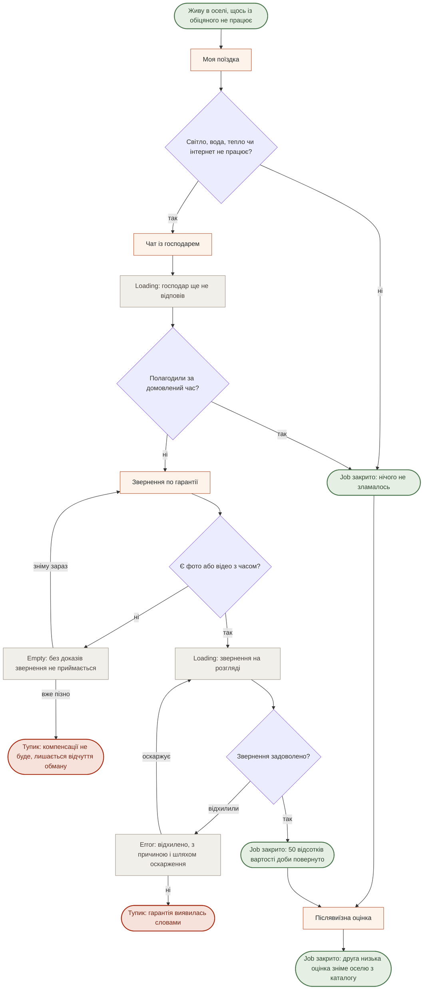

# User flows

**Крок 3.** Дата: 16.10.2026. Екрани — зі [`sitemap.md`](./sitemap.md), розділ «Екрани». Джоби — з [`research/jtbd.md`](../research/jtbd.md). Нових екранів жоден flow не зажадав.

**Конвенція.** `Start([...])` — тригер, з якого людина заходить. `[Екран]` — екран зі sitemap. `{Розвилка?}` — рішення людини або системи. `Loading:` / `Empty:` / `Error:` — **стани екрана**, не екрани. `Тупик([...])` — місце, де людина йде ні з чим. `Job закрито([...])` — успіх. Кольори через `classDef` — суто для читабельності, без них усе рендериться так само.

> **Три місця, де наш продукт розходиться зі звичним флоу маркетплейса житла.**
>
> **Кімнат немає** — завжди ціле помешкання, тож людина шукає оселю.
> **Заявки й схвалення немає.** Ні запиту на бронювання, ні підтвердження власником, ні застави — оплата повна й одразу. Тому замість «відповіли на заявку?» працюють **дати вільні?** і **платіж пройшов?**.
> **Чат відкривається після оплати, а не до неї.** У звичайному флоу діалог — спосіб набути довіри; у нас довіру мусять набути перевірка, блок недоліків і Розмова з господарем. Єдине справжнє відхилення в усьому продукті — **звернення по гарантії**.

---

## MAIN JOB — безпечно знайти, з ким і де жити

> Коли вдома вже не виходить відпочити, я хочу побути там, де вночі тихо, а вранці є вода й тепло, щоб повернути собі сон, сили та натхнення.

Персона: **«Та, хто їде нічого не робити»** ([`personas.md`](../research/personas.md), primary з 17.10.2026). Потік той самий і для тієї, хто їде надовго, — різниця лише в строку, який вона обирає на кроці дат.

**Розвилки**

1. **Знаю, як сформулювати?** На самому вході. «Ні» веде в Добірку, бо стан людина впізнає швидше, ніж називає параметри.
2. **Тепло і вода, якщо вимкнуть світло?** Перша змістовна відмова: вона дивиться не на красу.
3. **Достатньо довіри?** Вузол, через який проходить увесь продукт. Два обходи — Господар і Критерії відбору — обидва повертаються сюди ж.
4. **Дати вільні? · Ціна прийнятна? · Платіж пройшов?** Три системні перевірки на фініші. Тут у звичайному флоу стояло б «відповіли на заявку?».

**Стани:** `Loading` підбираємо оселі · `Empty` нічого не знайшлось, із виходом на послаблення фільтра · `Error` оселя зайнята на ці дати · `Loading` підтверджуємо платіж · `Error` оплата не пройшла.

**П'ять тупиків**

| Тупик | Де губимо | Чи відіграється |
|---|---|---|
| Повертається до OLX | Порожня видача | Так — порожній екран мусить вести в Добірки |
| Сумнів не знятий | Оселя | Так, і це головна робота продукту |
| Список лежить незайманий | Збережені | Частково. Нагадувати ми не вміємо й не хочемо |
| Ціна відлякала | Бронювання | Ні. Це рішення про каталог, не про інтерфейс |
| Оплата не пройшла | Оплата | Так — кілька способів уже в брифі |

---

## R3 — переконатись, що місце справжнє і таке, як описано

> Коли я плачу всю суму наперед людині, якої не знаю, я хочу бачити доказ, що оселя існує і виглядає як на фото, щоб не приїхати в інше місце.

У матриці [`jtbd.md`](../research/jtbd.md) — 3 бали primary і 3 бали персоні ③.

**Розвилки**

1. **Перевірка є?** Розвилка, якої немає в жодного конкурента: Airbnb перевірку робить, але доказ від гостя ховає ([ст. 3776](https://www.airbnb.com.ua/help/article/3776)).
2. **Недоліки справжні?** Найнебезпечніша. Декоративний список шкодить **більше**, ніж його відсутність — звідси правило «щонайменше три справжні» зі [`sitemap.md`](./sitemap.md).
3. **Профіль вселяє довіру?** Тут Розмова з господарем робить свою роботу, бо чат відкриється аж після оплати.

**Стани:** `Loading` вантажимо галерею й кадри перевірки · `Empty` цю оселю ще не перевіряли — сказати прямо, а не промовчати.

**Тупики:** декоративні недоліки · профіль не вселяє довіри. Другий відіграється лише вмістом — обличчям, ім'ям, голосом, — не кнопкою.

---

## R4 — домовитись саме на той строк, який потрібен

> Коли мені потрібно перебути лише найважчі місяці, я хочу домовитись саме на цей строк, не беручи на себе рік, щоб не платити за житло тоді, коли воно мені вже не потрібне.

3 бали primary, 3 бали ③, 3 бали ④. **Найсильніший related job із усіх.**

**Розвилки**

1. **Потрібен місяць і більше?** Розвилка, якої ринок не ставить узагалі: у Hutshub 90 відсотків бронювань — до трьох діб.
2. **Ціна за місяць окремо від доби?** Технічно рядок, по суті — весь джоб.
3. **Умова скасування зрозуміла?** Для довгого строку страшніше за ціну. У нас умова єдина для всіх — і це має стояти до оплати, а не в оферті.

**Стани:** `Loading` шукаємо вільні на довгий строк · `Empty` на такий строк нічого немає, із пропозицією розділити на два заїзди · `Loading` і `Error` на оплаті.

**Тупики:** «розсміються в обличчя» — те, що відбувається з нею на ринку сьогодні ([LB.ua, 15.10.2026](https://lb.ua/society/2026/10/15/773364_vid_pereyaslava_uzhgoroda_de.html)); якщо порожній стан не запропонує виходу, ми повторимо ринок у кращому оформленні · «множить добу на тридцять» коштує один рядок у картці · «боїться застрягти» знімається текстом умови скасування.

---

## E1 — перестати додавати собі невизначеності

> Коли я вже живу в оселі й щось із обіцяного не працює, я хочу знати, що робити і на що маю право, щоб не з'ясовувати це з нуля посеред поїздки.

Єдиний потік, де є **справжнє відхилення заявки**: гарантія без механізму розгляду — просто текст.

**Розвилки**

1. **Щось не працює?** Вхід із «Моєї поїздки», **не з довідки**: коли немає води, людина відкриває свою поїздку, а не FAQ.
2. **Господар полагодив сам?** Навмисний перший крок — більшість випадків мусить закриватись тут, інакше платформа платить за кожну перегорілу лампочку.
3. **Є докази?** Найжорсткіша. Без неї гарантія не працює, але вона ж створює тупик для того, хто не здогадався зняти відео вчасно — тому попередити треба **в підтвердженні бронювання**, а не в момент звернення.
4. **Звернення задоволено?** Єдина справжня відмова в продукті. Причина обов'язкова.

**Стани:** `Loading` господар ще не відповів, із зазначенням домовленого часу · `Empty` без доказів не приймається — сказати **до** заповнення форми · `Loading` на розгляді, зі строком · `Error` відхилено, з причиною і шляхом оскарження.

**Тупики:** «не зняла доказ вчасно» — передбачається лише заздалегідь, рядком у підтвердженні · «гарантія виявилась словами» — найдорожчий тупик у продукті: людина, якій відмовили, забирає з собою рівно те відчуття, проти якого ми будуємося.
